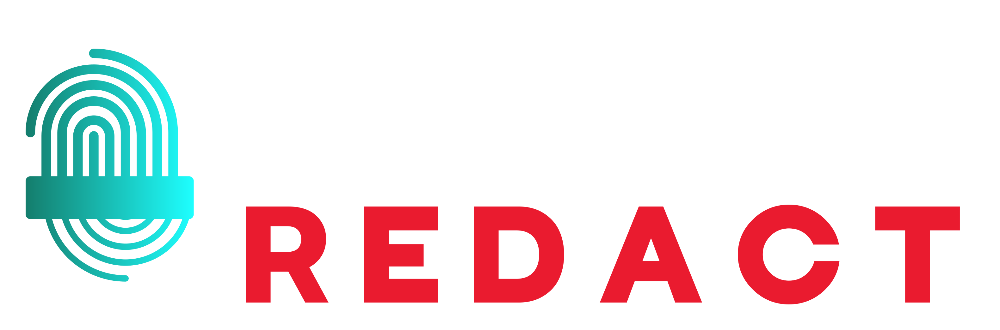

<div align="center">


[](https://www.rust-lang.org/)
[](LICENSE)
[](https://github.com/censgate/redact/actions)
[](https://crates.io/crates/redact-core)
[](https://crates.io/crates/redact-gateway)

**Detect and redact PII and secrets — then prove what left.**

For teams that gate secrets in CI, inventory PII in Postgres, or send prompts
to a model provider and need a third party to verify the evidence pack.
One Rust engine: CLI, gateway, scanner, WASM. Apache-2.0.

```bash
cargo install redact-cli
redact analyze --fail-on-detect "Email jane@example.com"
```

[Quick Start](#quick-start) · [Evidence](#evidence-and-attestation) · [Docs](docs/README.md) · [Contributing](#contributing)

</div>

---

- **Secrets in CI** — `redact analyze --fail-on-detect`. Deterministic, no NER, no network. Adjacent to gitleaks, at runtime rather than at rest. Default compiled set is **61** types (`redact --format json list-entities`); the long tail is an opt-in pack, not gitleaks parity.
- **Postgres PII discovery** — `redact-scan`. Read-only (replica/staging preferred). Locations and counts only; sample values never leave the host. `--report-url` is an explicit opt-in POST of that findings JSON. An input to a records-of-processing inventory (GDPR Art. 30), not a certification.
- **Prove what left** — gateway + ledger + `redact-verify`. The gateway is the delivery mechanism. The evidence pack is what a third party can check offline.
- **Embed the engine** — `redact-core` library, REST API, and pattern-only WASM.

p50 latency vs Presidio was **32×** on the 2026-04-18 oha payload ([benchmark](docs/benchmarks/results-20260418-175909.md)). That is a throughput/latency measurement, not a quality score.

## Evidence and attestation

Gateway audit records ([schema](docs/gateway/audit.md)) are written by the
operator who ran the proxy. The in-process queue can drop under load, the sink
is operator-controlled, and records can be rewritten.

Censgate ledger evidence packs are a different artifact. The current sealed
format is one JSON envelope with the exact body bytes encoded in standard
base64. The offline redact-verify library checks the body SHA-256, pack
Ed25519 signature, each per-record Ed25519 signature, each platform-v1 record
hash projection, and chain continuity. Pack-supplied public keys are compared
with independently supplied local keys and never establish trust themselves.

An optional R1 tree head carries a root string and ECDSA signature. The
verifier checks that signature only when an independent local P-256 or P-384
key is supplied. The current format has no inclusion path or specified link
between its root and exported records, so a valid root signature is not
reported as record inclusion. Tail and global coverage also remain unproven
because there is no authenticated close boundary or heartbeat contract.

redact-verify is offline and has no redact-core dependency. The reserved
--online option prints a notice and makes no network calls. Exit 0 means the
required local checks passed; exit 1 means evidence failed; exit 2 means
required evidence is unproven or input could not be read or parsed. A verified
signed tombstone extension returns erased with exit 0.

Pack and ledger hashes refer to redacted material. The verifier rejects
explicit raw-input plain-hash fields and treats a keyed raw commitment as
opaque; it never requests raw input, a salt, keys, or an online opening.
Current public metadata is aligned with the AAT draft (draft-09), while the
platform-v1 canonicalisation differs from native JCS/AAT chaining. BagIt,
JSONL, authenticated coverage, and independent Redact attestation wire formats
remain future contracts absent from the current reference.

Compliance YAML under patterns/compliance/ maps which entity types a profile
treats as in-scope.

Verifier: [crates/redact-verify/README.md](crates/redact-verify/README.md).

## Quick Start

### Secrets in CI and pre-commit

Zero extra services. Deterministic pattern engine; NER is off unless you add it.

<!-- redact-doc-examples: skip -->
```bash
cargo install redact-cli
redact analyze --fail-on-detect -i secrets-check.txt
```

`--fail-on-detect` exits 1 when anything is detected; output still prints.
Without the flag, `analyze` exits 0 on success regardless of detections.

<!-- redact-doc-examples: skip -->
```bash
# Pre-commit (NUL-safe paths; skip when nothing is staged)
if [ "$(git diff --cached --name-only -z --diff-filter=ACMRT | wc -c)" -gt 0 ]; then
  git diff --cached --name-only -z --diff-filter=ACMRT | xargs -0 redact analyze --fail-on-detect -i || exit 1
fi
```

```bash
redact analyze "Contact Jane at jane@example.com or call (555) 123-4567"
redact anonymize --strategy mask "Email: jane@example.com"
redact --format json list-entities
redact -l es analyze --fail-on-detect "correo maria@example.es"
```

`-l` / `--language` is an ISO 639-1 hint (default `en`). Pattern, secret, and pack
recognizers run for every language. NER, when loaded, stays language-specific.

`--disable` subtracts from the compiled set (or from `--entities` when both are
set). Gateway equivalent: `{ action: allow }` on the profile.

### Postgres PII discovery

Read-only. Prefer a replica or staging database. The report is locations and
counts — never sample values. Superuser and write grants are refused.

```bash
cargo install redact-scan
redact-scan --url postgres://reader@localhost/app --schema public --out report.json
```

Crate: redact-verify 0.12.7. The verifier checks local body and record signatures;
an R1 signature is optional and requires an independently trusted tree-head key.
Exit 0 is pass or erased, exit 1 is fail, and exit 2 is unproven or unreadable input.
Gateway walkthrough: [`docs/gateway/getting-started.md`](docs/gateway/getting-started.md).
Image: `ghcr.io/censgate/redact-gateway:latest`.

### Embed the engine

Library (version pin is updated by Prepare Release):

```toml
[dependencies]
redact-core = "0.12.7"
redact-ner = "0.12.7"  # optional ONNX NER
```

```rust
use redact_core::AnalyzerEngine;

let engine = AnalyzerEngine::new();
let result = engine.analyze("Email jane@example.com", None)?;
```

WASM (pattern engine only — not `redact-core` compiled alone):

```bash
rustup target add wasm32-unknown-unknown
wasm-pack build --target web crates/redact-wasm
```

REST: `cargo run --release -p redact-api` then `POST /api/v1/analyze` or
`POST /api/v1/anonymize`. The JSON `language` field is the same ISO 639-1 hint
as the CLI flag (default `en`). Pattern, secret, and pack recognizers run for
every language.

```bash
curl -s http://127.0.0.1:8080/api/v1/analyze \
  -H 'content-type: application/json' \
  -d '{"text":"correo maria@example.es","language":"es"}'
```

Install and Docker: [`docs/install.md`](docs/install.md). WASM details:
[`docs/wasm.md`](docs/wasm.md). NER: [`docs/ner.md`](docs/ner.md).

## Documentation

- [Docs index](docs/README.md)
- [Entity types](docs/entity-types.md) — 61 compiled types; source of truth is `list-entities`
- [Secrets detection](docs/secrets-detection.md)
- [Postgres scanning model](docs/scanning-model.md)
- [Gateway](docs/gateway/getting-started.md)
- [Project structure](docs/project-structure.md) · [Testing](docs/testing.md) · [Roadmap](docs/roadmap.md)
- [Project scope](docs/PROJECT_SCOPE.md) · [Contributing](CONTRIBUTING.md)
- [docs.rs/redact-core](https://docs.rs/redact-core) · [Examples](examples/)

## Contributing

Read [CONTRIBUTING.md](CONTRIBUTING.md), [CODE_OF_CONDUCT.md](CODE_OF_CONDUCT.md),
[docs/PROJECT_SCOPE.md](docs/PROJECT_SCOPE.md), and [CLA.md](CLA.md).

New prefixed provider tokens belong in a YAML **pattern pack**, not in
`redact-core`. Core will not absorb the full gitleaks rule set. See
[CONTRIBUTING.md](CONTRIBUTING.md#pattern-pack-prs-provider-coverage).

Sign every commit (`git commit -s`). The CLA bot asks first-time human
contributors to sign on the pull request.

## License

[Apache License 2.0](LICENSE). Copyright (c) 2026 Censgate LLC.

## Support

- [GitHub Issues](https://github.com/censgate/redact/issues)
- Email: support@censgate.com
